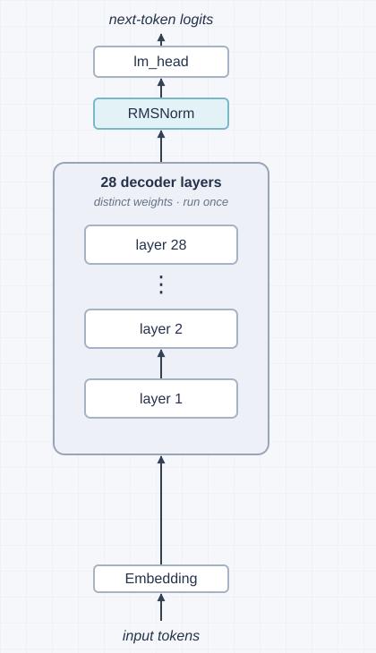
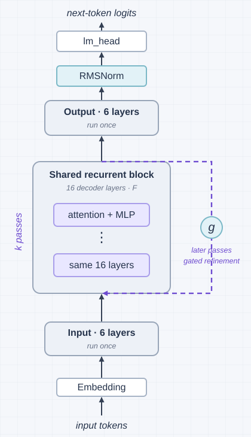
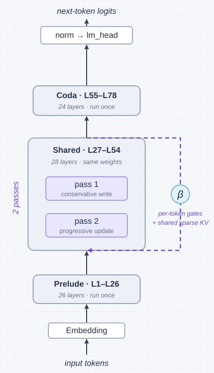
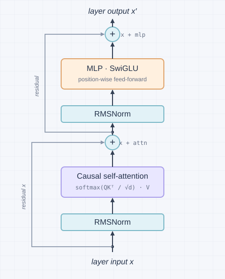
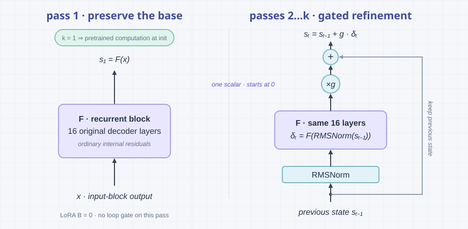
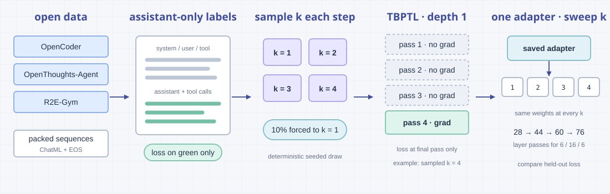
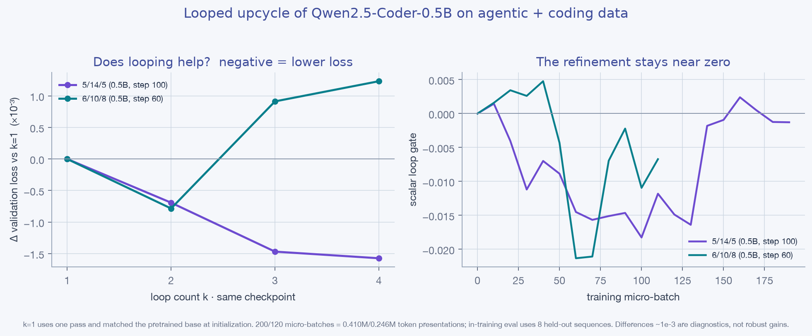

# Looped Transformer — small-scale upcycling experiment


Can a pretrained coding model be turned into a **looped (latent-recurrent)** model
that gets better with more inference-time loops? This repo reproduces the core ideas of
NVIDIA's [Dory1.0-4B](https://arxiv.org/abs/2611.03998) at a scale that fits on a laptop
and a single Colab GPU.

**What is here**

- A `LoopedCausalLM` wrapper that splits a Qwen2/Llama model into **input / shared
  recurrent / output** blocks and applies the recurrent block `k` times.
- Training with **loop-count sampling**, **truncated backprop through loops (TBPTL)**,
  assistant-only loss, and LoRA.
- An open **agentic + coding** data pipeline (OpenCoder, OpenThoughts-Agent, R2E-Gym)
  with a `` chat template for assistant masks.
- A **Colab notebook** for the 1.5B / ~16M-token run.
- Honest small-scale results, including a negative one.

---

## Why this is interesting

Looping trades **parameters** for **compute**: the same recurrent block is applied
repeatedly, so a single checkpoint can be served at different depths (`k=1,2,3,4`).
Dory1.0-4B showed that this can match much larger models and reduce generated tokens.
The open question for a small model is whether the idea survives at laptop/Colab scale.

## Same weights, more steps

Read the diagrams **bottom to top**. A standard transformer gives every stored layer
one pass. A looped transformer sends the state through a shared middle block again.
The animated, clickable version lives in
[`docs/visual_transformer_vs_loop.html`](docs/visual_transformer_vs_loop.html).

<p align="center">
  
  
  
</p>

- **Standard Transformer** — `N` distinct layers means `N` layer passes.
- **This repo** — the 28-layer Qwen stack is partitioned **6 / 16 / 6**. The middle
  16 layers are the same module on every pass, so `k=1,2,3,4` gives
  **28 / 44 / 60 / 76 layer passes** without adding stored decoder layers.
- **GLM 5.4** (Z.ai) — 26 + 28 + 28 + 24 = **106 layer passes from 78 stored layers**.
  Its recurrence and cache system are different from this repo's; see the comparison below.

### Inside each decoder layer: nothing changes

Every decoder layer—whether run once or reused—keeps its ordinary pre-norm residual
structure. The experiment does **not** put a new gate on attention or MLP residuals.

<p align="center">
  
</p>

- **Norm** — RMSNorm before each sub-block.
- **Attention** — causal self-attention with the base model's projections and RoPE.
- **MLP** — the base model's SwiGLU feed-forward network.
- **Residuals** — `x ← x + attn(norm(x))`, then `x ← x + mlp(norm(x))`.

### Outside the block: the recurrence changes

Let `F` be the **entire shared 16-layer block**, not one decoder layer. The reported
runs disable input injection and use this base-preserving recurrence:

<p align="center">
  
</p>

```text
pass 1:        s₁ = F(x)
passes 2…k:    δₜ = F(RMSNorm(sₜ₋₁))
               sₜ = sₜ₋₁ + g · δₜ
```

- At initialization, pass 1 is the untouched pretrained computation, so **`k=1`
  matches the base model** (verified loss difference about `1e-6`).
- `g` is **one learned scalar outside the whole recurrent block**. It starts at zero,
  so extra passes also start as no-ops. It is not a per-token gate.
- After adaptation begins, `k=1` is the same trained checkpoint with one pass—not the
  original pretrained checkpoint—because LoRA and the loop-boundary parameters train.
- `inject_input=True` (the constructor default) enables the separate Dory-style ablation
  `δₜ = F(RMSNorm(sₜ₋₁ + x))`. The reported runs turn it off with `--no-inject-input`.

### What the experiment looks like end to end

<p align="center">
  
</p>

For a sampled `k=4` training step, passes 1–3 run under `no_grad`; only pass 4 is
differentiated (**TBPTL depth 1**), and loss is computed only at the final pass.
The trainer's default LoRA adapters target attention and MLP projections in all three
partitions; the pretrained linear weights stay frozen, while the loop norms and gate
remain trainable. Evaluation then sweeps `k` on the **same saved adapter**.

<small>Diagram layout and animation concepts adapted from <a href="https://www.k-a.in/loop-transformer.html">arjun kocher’s Loop Transformer</a>, <a href="https://creativecommons.org/licenses/by/4.0/">CC BY 4.0</a>. Typography, palette, SVGs, and explanations are independently reworked for this repository.</small>

### What GLM 5.4 does (per the Z.ai launch blog, 2026-11-23)

- First Z.ai flagship built on the **Loop Transformer** — ~750B parameters, comparable to 2T–3T models, targeting "Generalized Coding".
- Loops 28 layers twice (see diagram above): 26 prelude + 28 + 28 + 24 = **106 layer passes per token from 78 stored layers**.
- **Gated Progressive Updates** — `x₁ = x₀ + β₁(h₁ − x₀)`: per-token, per-iteration gates write candidate updates back proportionally. Pass 1 writes conservatively; pass 2 opens the gates.
- **Hybrid KV cache** — reuses pass 1's sparse KV and adds only a 128-token sliding window per extra loop (≈ one window of KV, not a full context — matters at 1M context).
- **Sparse attention index reuse** — pass 2 reuses pass 1's attention indices (≈ zero indexing overhead).
- Iso-parameter ablation (30B vs 750B) shows clear gains on long reasoning; average thinking length drops 10–14%.

### This repo vs GLM 5.4

| | This repo | GLM 5.4 |
| --- | --- | --- |
| Base | upcycle Qwen2.5-Coder-1.5B | continued-train 750B base |
| Recurrence | base-preserving gated residual; `k ∈ {1..4}` | loop 28 layers ×2; per-token gates |
| Extras | TBPTL depth 1; LoRA r=16 smoke runs / r=32 planned L4 | hybrid KV + sparse index reuse |

## Architecture

```
tokens ─► embed ─► [ input block ×6 ] ─► x
                                         │
                ┌────────────────────────┘
                ▼
        s = recurrent_block(x)          # loop 1: base-preserving passthrough
        for t in 2..k:
            d = recurrent_block(norm(s))
            s = s + gate · d            # one scalar gate, outside all 16 layers
                │
                ▼
        [ output block ×6 ] ─► norm ─► lm_head ─► logits
```

For a 28-layer `Qwen2.5-Coder-1.5B` the partition is **6 / 16 / 6**; the recurrent
block is the *same module object* applied `k` times (weights shared by construction).

### The upcycling trick

The paper's exact recurrence (`u = N(s + x)`, `s = N(F(u))`) is a poor initialization
for a **pretrained** model: it makes `k=1` differ from the base. Instead we use a
**base-preserving gated residual**:

- loop 1 is the original pretrained stack, so **at initialization `k=1` is numerically
  identical to the base model** (verified: loss diff `1e-6`);
- later loops add a learned, gated refinement `s = s + gate · F(norm(s))`;
- `gate` starts at 0, so `k>1` starts identical to `k=1` and learns how much the loop
  should contribute.

## Results (0.5B LoRA smoke runs, Mac M6)

The main 5/14/5 run used **200 micro-batches × batch 1 × 2,048 tokens = 409,600
raw token presentations** and 50 optimizer updates. The 120-micro-batch ablations used
245,760 token presentations and 30 updates. In-training evaluation points average only
**8 held-out sequences**; the final 5/14/5 evaluation below uses 4.

At initialization, `k=1` matches the pretrained base; in these trained-adapter sweeps,
`k=1` means one pass through the adapted checkpoint. Negative Δ means the loop helps.



| Run | k=1 | k=2 | k=3 | k=4 |
|---|---|---|---|---|
| 5/14/5, step 100 | 1.1563 | 1.1556 | **1.1549** | **1.1548** |
| 6/10/8, step 60 | 1.3167 | **1.3159** | 1.3176 | 1.3179 |

Final 5/14/5 adapter on a random held-out split: k=1 `1.0689`, k=2 `1.0685`,
k=4 `1.0696`.

**Interpretation.** The loop gives a ~`1e-3` gain at `k=2`, and deeper loops do not
help at this budget. A forced gate init of `0.05` is actively harmful — the optimizer
drives it down to `0.019` and k=1 wins. This is a pipeline validation, not a verdict on
the architecture: Dory used **1.5T looped tokens**, while the main run presents only
~0.41M tokens. The 1.5B / ~16M-token-presentation Colab run is the next step.

## Quick start

### Local (Mac / CPU / CUDA)

```bash
git clone <your-repo-url>
cd looped-transformer
uv venv .venv --python 3.13
uv pip install --python .venv/bin/python -e .[tracking]

# structural test (no downloads)
PYTHONPATH=. .venv/bin/python scripts/smoke_model.py

# k=1 == pretrained base
PYTHONPATH=. .venv/bin/python scripts/check_k1_equivalence.py

# build a small packed dataset
PYTHONPATH=. .venv/bin/python data/build_mix.py build \
  --out data/packed_smoke --tokenizer Qwen/Qwen2.5-Coder-1.5B \
  --seq-len 512 --max-examples 2000 --max-sequences 500

# smoke train (MPS)
PYTHONPATH=. .venv/bin/python -m looped.trainer \
  --base-model Qwen/Qwen2.5-Coder-0.5B --data-dir data/packed_smoke \
  --out-dir runs/smoke --n-input 5 --n-recurrent 14 --n-output 5 \
  --seq-len 512 --batch-size 2 --grad-accum 2 --max-steps 100 \
  --eval-every 50 --device mps --dtype bfloat16 --lora-rank 16 \
  --no-inject-input --gate-lr-mult 100
```

### Colab

Open [`notebooks/01_colab_train_l4.ipynb`](notebooks/01_colab_train_l4.ipynb). It:

1. checks the GPU and installs dependencies,
2. mounts Drive and logs in to W&B,
3. clones/copies the code,
4. builds the packed dataset,
5. trains `Qwen/Qwen2.5-Coder-1.5B` with LoRA + loops on an L4/A100,
6. evaluates the `k=1/2/3/4` sweep.

Add `WANDB_API_KEY` and `HF_TOKEN` to Colab Secrets. A T4 fast path and an optional
non-looped baseline cell are included.

## Repository layout

```
looped/
  model.py        # LoopedCausalLM, LoRA, loop recurrence, TBPTL
  trainer.py      # loop sampling, training loop, eval, checkpoints
data/
  build_mix.py    # OpenCoder + OpenThoughts-Agent + R2E-Gym → packed arrays
scripts/
  smoke_model.py            # structural test
  check_k1_equivalence.py   # k=1 == base model
  test_real_model.py        # real-model MPS smoke test
  eval_adapter.py           # k-sweep for a saved adapter
  plot_k_sweep.py           # plot eval.jsonl
  make_results_figure.py    # regenerate the figure above
  make_colab_notebook.py    # regenerate the notebook
notebooks/
  01_colab_train_l4.ipynb
results/
  RUN_LOG.md      # full experiment log
  k_sweep.png     # results figure
  logs/           # committed eval/train JSONL used by the figure
docs/
  visual_transformer_vs_loop.html   # interactive architecture + experiment explainer
  diagrams/                         # standalone SVG figures used by this README
PLAN_looped_transformer_colab.md
```

## Dataset mix

| Source | Config | License | Role |
|---|---|---|---|
| `OpenCoder-LLM/opc-sft-stage2` | `educational_instruct` | MIT | coding |
| `open-thoughts/OpenThoughts-Agent-SFT-100K` | default | Apache-2.0 | agentic |
| `R2E-Gym/R2EGym-SFT-Trajectories` | default | Apache-2.0 | SWE |
| `nvidia/Nemotron-SFT-SWE-v3` (optional) | one parquet shard | CC BY 4.0 | SWE |

Assistant-only labels are produced with a ChatML `` template. Long
system/tool messages are capped so assistant turns survive truncation.

## What I learned

- **Upcycling needs a base-preserving init.** The exact Dory recurrence is a poor
  starting point for a pretrained model; the gated residual makes k=1 exact at
  initialization and lets the loop start as a no-op.
- **The loop is compute-hungry.** The main run's 0.41M token presentations of LoRA
  adaptation are nowhere near the paper's 1.5T looped tokens. At this budget the gate
  stays near zero.
- **Engineering matters.** TBPTL depth 1, packed assistant-only labels, gradient
  checkpointing, and adapter round-tripping are what make the experiment run at all.

### Next steps

- 1.5B / ~16M-token L4 run (notebook ready).
- Per-source eval: coding vs. agentic, since loops should help hard reasoning more.
- Difficulty-aware loop routing (the paper's `α=0.3` curriculum).
- Input injection (`inject_input=True`, Dory-style) and full fine-tune / higher-rank LoRA ablations.
- A non-looped LoRA baseline at the same budget.

## References

- Dory1.0-4B: *A Looped Normalized-GPT* — <https://arxiv.org/abs/2611.03998>
- nGPT: *Normalized Transformer with Representation Learning on the Hypersphere* —
  <https://arxiv.org/abs/2410.01131>, [`NVIDIA/ngpt`](https://github.com/NVIDIA/ngpt),
  [`lucidrains/nGPT-pytorch`](https://github.com/lucidrains/nGPT-pytorch)
- Huginn / recurrent depth — <https://arxiv.org/abs/2502.05171>,
  [`seal-rg/recurrent-pretraining`](https://github.com/seal-rg/recurrent-pretraining)
- Looped LM scaling — [`kschwethelm/looped-lm-scaling`](https://github.com/kschwethelm/looped-lm-scaling)
- nanochat — <https://github.com/karpathy/nanochat>

## License

MIT. See [`LICENSE`](LICENSE).
